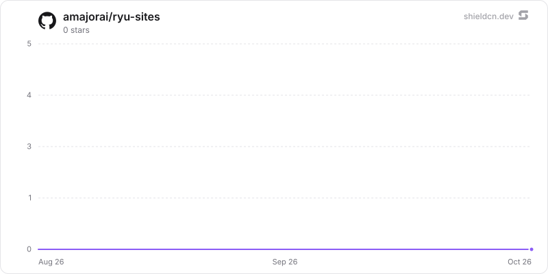

<div align="center">

# sites

</div>

Create, preview, and deploy self-contained websites with saved versions, secret-scanned deploys, and a separate visitor origin, as a Ryu Desktop app or a standalone service.

> **The public home of `ryu-sites`.** Source, builds, and releases live here —
> binaries for every platform are attached to each release.
>
> This tree is generated from the Ryu monorepo, so commits pushed here
> directly are replaced on the next sync. **Pull requests are welcome** —
> open them here and they are ported into the monorepo, then flow back out.
> Ryu as a whole: https://github.com/amajorai/ryu

## Install

**App:** [Install](ryu://apps/com.ryu.sites) (opens the Ryu desktop app and asks you to confirm)

**CLI:**

```bash
ryu apps add com.ryu.sites
```

## Source & build

The **source of record** for this app: a Bun/TypeScript
`sidecar/` Ryu runs locally as a grant-gated control capability, plus the
manifest `ui/`. The sidecar builds standalone — `cd sidecar && bun install &&
bun run build` compiles a single `ryu-sites` executable; each release attaches
the per-platform binaries.

## License

Apache-2.0 — see [LICENSE](./LICENSE).

## Build and verify

From the Ryu workspace:

```sh
bun run --cwd apps-store/sites/sidecar build
bun run --cwd apps-store/sites/ui build
bun run --cwd apps-store/sites/sidecar test
bun run --cwd apps-store/sites/ui test
```

The sidecar build regenerates the browser runtime from the shared browser data
primitives. Bundler output differs between Bun releases, so `src/visitor-bundle.ts` is
generated only with the workspace's pinned Bun (`packageManager` in the root
`package.json`); with another Bun release the build keeps the checked-in runtime.
`bun run --cwd apps-store/sites/sidecar check:runtime` fails when the checked-in
runtime no longer matches its source, and the sidecar tests run the same comparison
under the pinned Bun. The source Companion bundles the existing Ryu controls and App UI
layouts.

## Operator configuration

Use the Core-minted `RYU_EXT_TOKEN` and injected `RYU_SITES_PORT` under normal lifecycle
management. Tests that exercise the Core-managed shape without Core can use
`RYU_SITES_TOKEN`; it is not a standalone credential. Store data beneath an isolated
`RYU_DIR` with `RYU_PROFILE=dev` and `RYU_KEYCHAIN=off` for unattended testing.

Sites keeps `sites.sqlite`, `visitor-quota.key` and the optional `runtime.json` in its
plugin data folder, `$RYU_DIR/plugin-data/@ryu+sites/` (`resolvePluginDataDir` in
`src/sidecar.ts`). `RYU_PLUGIN_DATA_DIR`, which Core injects, replaces that folder.

- `RYU_SITES_PUBLIC=1` enables the public audience; the default is disabled. The
  setting is applied on every request: turning it off suspends Sites already saved as
  public (they become owner-only) until it is re-enabled or the owner picks another
  audience.
- `RYU_SITES_VISITOR_PORT` selects the separate loopback visitor listener.
- `RYU_SITES_TRUSTED_PROXIES` (or `trustedProxies` in `runtime.json`) lists
  comma-separated proxy addresses or CIDRs, such as `127.0.0.1` for a tunnel or edge on
  the same host. Only when the connecting peer is trusted, Sites reads `X-Forwarded-For`
  right to left and uses the nearest untrusted hop as the visitor address. Rate limits
  (120 requests per minute per visitor address and 6,000 per Site) and the analytics
  digest use that address. Without it, every visitor behind a local edge shares the
  edge's address and its per-visitor budget.
- `POST /_ryu/complete` (visitor SDK `RyuSite.ai.complete` / `RyuSite.ai.chat`) is
  general in-page AI. It answers only when `settings.ai` is on, `settings.aiMode` is
  `general` (default `grounded`, which keeps `/_ryu/ask` as the only AI route), the
  Site is connected, and the Core `model.complete` path is available. A visitor must be
  signed in unless `settings.aiAnonymous` is on. The system text is the sidecar guard,
  then `settings.aiSystemPrompt`, then the page's `system` (2,000 characters); the
  prompt or chat transcript is capped at 8,000 characters (413), `maxTokens` is
  clamped to 1–2,000 and the reply is cut to 4 characters per token. Each call spends
  one answer from `aiDailyLimit` and the visitor's share (429). A missing or failing
  model, or an empty reply, is a 503, never substitute text.
- Per-visitor AI answer shares are stored in `operation_usage` as
  `HMAC(visitor-quota.key, Site, UTC day, visitor)` (`src/visitor-quota.ts`), so a
  restart keeps each share while digests from different days stay unlinkable and never
  hold a raw account ID or address. The 32-byte key is created once beside
  `sites.sqlite` (`0600`, written to a temporary file and hard-linked into place so
  concurrent starts agree); a key of any other size refuses startup. Page-view
  analytics digests keep a per-process salt.
- `RYU_SITES_DOMAIN` selects the managed suffix; the local default is `localhost`.
- `RYU_SITES_EDGE_READINESS_URL` (or `edge.readinessUrl` in `runtime.json`) is an
  optional `https://` URL template containing `{host}`. It wires `services.domainReady`
  (`src/edge-readiness.ts`): after the ownership TXT record verifies, **Check DNS and
  TLS** sends a certificate-validated GET (no redirects, 5 s timeout, 4 KB reply cap)
  and marks the domain active only for `200` with `{"ready": true, "host": "<domain>"}`.
  An edge that forwards custom domains to the visitor listener can use
  `https://{host}/_ryu/edge-ready`, which the visitor listener answers for any bound
  domain. That form proves only what the tenant's DNS and server say, so when
  `{host}` is in the hostname Sites resolves it, refuses any non-public answer
  (loopback, RFC 1918, CGNAT, link-local and metadata, ULA, documentation,
  multicast and IPv4-embedding IPv6 prefixes), and pins the connection to the
  screened address with SNI and certificate checks for the hostname. For an
  edge-attested check use the edge's own API, e.g.
  `https://edge.example.com/ready?host={host}` (a fixed operator host is not
  screened). Unset (the default), no edge ships, `/status` reports `domainsAvailable:
  false`, and verified domains stay `pending_tls`.
- `RYU_SITES_ISSUER`, `RYU_SITES_CLIENT_ID` and optional `RYU_SITES_CLIENT_SECRET`
  connect a registered platform OIDC client. Register each callback origin at the
  identity provider. `RYU_SITES_OWNER_ID` must match the verified owner subject.
- The injected `RYU_CORE_PORT` and app-only extension token connect Core host primitives.
  `RYU_SITES_BINDINGS_FILE` names an operator-owned JSON object mapping site IDs to
  arrays of approved knowledge Space IDs. The `spaces:docs` and `spaces:database`
  host grants must be approved in Ryu. Visitor records are stored in a private Ryu
  Spaces database for each Site. On a managed node, `RYU_SITES_OWNER_JWT` supplies a
  verified owner identity and must be refreshed before it expires.
  Removing a binding denies subsequent retrieval even if the site still selects it.

Management requests arrive through Core's ext-proxy, which strips the caller's
user JWT and stamps the verified `x-ryu-caller-user-id`, `x-ryu-caller-org-id` and
`x-ryu-caller-email` after admitting the hop bearer (Core strips caller-supplied
copies of all three first). Core stamps the email only because `manifest.json`
opts in with `http.forward_caller_email`; other sidecars never receive it. The
email is the identity token's `email` claim, stamped only when the token also
carries `email_verified: true`. An unverified address is omitted (and
`identity.current` reports an empty email for it), so it never satisfies a named
editor or invited viewer.
Sites trusts those headers only on a bearer-verified hop
and refuses values over 256 characters or with control characters. On an
org-registered node they select the member (a hop without a user ID is refused); on
an unbound node every admitted caller is the configured owner. The lower-cased email
matches named editors (who must also belong to the Site's workspace) and invited
viewers.

These values are process wiring, not part of a public site artifact. Never put them
in prompts or generated HTML. The public guide describes supported behavior without
exposing this operational wiring.

## Agent tools (MCP)

`ryu-sites mcp` (`src/mcp-server.ts`, dispatched from `src/index.ts`; the sidecar
itself boots from `src/sidecar.ts`) serves the `sites` MCP server declared in
`manifest.json` (`mcp_servers.sites`, grant `mcp:sites`) to the bundled
`sites-agent` runnable. Tools: `sites_list`, `sites_get`, `sites_get_source`,
`sites_create`, `sites_save_version`, `sites_deploy`, `sites_set_access`.

The MCP process never opens `sites.sqlite`. It calls the running sidecar's loopback
management API with the per-plugin `RYU_EXT_TOKEN` Core injects into both processes,
so it gets exactly the Companion's validation, quotas, `expectedRevision` checks,
secret scan before deployment and owner/editor rules. The endpoint comes only from
`management-endpoint.json`, which the sidecar writes beside `sites.sqlite` at
startup (unlinked and recreated exclusively, `0600`, `{port, secret}` with a random
per-process secret) and removes on shutdown; the host is always `127.0.0.1` and
there is no default port. Before each call the lane sends a fresh challenge to the
unauthenticated `GET /api/sites/instance-proof` and sends the bearer only when the
listener returns HMAC-SHA256(secret, challenge); a missing record or a failed proof
is `sites_unavailable`, so a process that took over a stale port never receives
`RYU_EXT_TOKEN`. Core forwards no verified caller into a stdio `tools/call`, so the
lane sends no `x-ryu-caller-*` headers: on an unbound node the bearer hop resolves to
the configured owner (as a Companion hop does), and on an org-registered node
`identity.current` must supply the principal or the call is refused.

Each call carries `x-ryu-sites-client: agent-tools`. On a bearer-verified hop the
sidecar records each successful mutation in `site_audit` as `agent.tool` (actor,
operation, revision, deployment; never HTML or access lists), keeping the newest 500
per Site. The header only labels the audit; it grants nothing. One MCP process allows
120 tool calls and 30 writes per minute. `sites_save_version` applies the shared
`artifactProblem` rules (doctype, 2 MB) before sending and returns the secret-scan
result for the saved version. The agent generates HTML itself; the tools do not call
a model. There are no remix, duplicate, owner-connection or shared-data tools yet;
those stay in the Companion and the HTTP/visitor routes.

## Standalone mode

`RYU_SITES_MODE=standalone` (or `RYU_SITES_API_TOKEN` alone) runs Sites as its own
service, one tenant per process. `src/standalone-config.ts` owns the contract:

- `RYU_SITES_API_TOKEN` is the only management credential: at least 32 characters,
  not a placeholder, compared in constant time. Standalone startup refuses
  `RYU_EXT_TOKEN` and `RYU_SITES_TOKEN`, ignores `RYU_CORE_PORT` and
  `RYU_SITES_OWNER_JWT`, and never builds a Core host client, so the bearer is never
  sent to a Core port. A visitor session never authenticates management requests.
- `RYU_SITES_HOSTNAME` and `RYU_SITES_VISITOR_HOSTNAME` are IP bind addresses
  (default `127.0.0.1`). Any mode refuses a non-loopback management bind without the
  standalone bearer. `RYU_SITES_MODE=core` refuses `RYU_SITES_API_TOKEN`.
- `GET /` on the management listener is tokenless. It returns `307` to
  `RYU_PRODUCT_DASHBOARD_URL` only when that variable is set to a non-empty URL
  (Ryu's hosted deployment sets it to the Ryu organization dashboard); otherwise it
  returns `200` with `{"name": "ryu-sites", "version": "<manifest version>", "health":
  "/health"}`, matching the Gateway. A self-hosted Sites never sends people to Ryu by
  default. Core mode keeps its bearer-only behavior.
- Deploy scans use `src/secret-scan.ts`: the Gateway's built-in secret patterns plus
  common provider key formats. With `RYU_SITES_GATEWAY_URL` (HTTPS, or HTTP to
  loopback) and optional `RYU_SITES_GATEWAY_KEY`, the artifact must also pass that
  Gateway's `POST /v1/firewall/check` secret guardrail; an unreachable Gateway blocks
  the deploy.
- Durable visitor records use `src/local-database.ts`, the `SitesSpacesDatabase`
  contract over a `site_database_records` table in `sites.sqlite`, with the same
  Site, per-visitor and storage limits. The SQL console runs each read-only query in
  a short-lived `bun -e` helper (minimal environment, capped SQLite heap,
  `query_only`) that is killed after 3 seconds, because Bun's SQLite binding cannot
  interrupt a statement.
- Spaces retrieval, AI answers and general in-page AI (`completionsAvailable`), owner
  reset checks, plugin installation, operator and owner visitor connections
  (`connectionsAvailable`, `ownerConnectionsAvailable`) and the `sites` agent tools
  stay Core-only; `/status` reports them unavailable, `PUT /projects/:id/connections`
  answers `503`, and settings refuse general AI mode.
- Shared visitor data works over the local records store once a Site is in connected
  mode with a connected database and an OIDC client is configured. Remix and
  duplicate work too, but one management bearer owns every Site, so
  `scope=remixable` is empty and the route acts as a duplicate.

`Dockerfile` (build context: the repository root) installs the locked workspace
dependencies, bundles the sidecar, runs it as uid 10001 with data under `/data`, and
exposes 8021 (management) and 8022 (visitors). It sits outside `sidecar/` because it
needs the monorepo `bun.lock`; the public satellite is built from `sidecar/`.

The public operator guide is `apps/fumadocs/content/docs/standalone/sites.mdx`, with
routes in `sites-api.mdx`.

## At rest

`sites.sqlite` seals visitor data and Site state per value with the `@ryu/sites` plugin
subkey (ChaCha20-Poly1305, store `sites.sqlite`; `@ryu/sidecar-runtime/content-seal`):

- `sites.state` (settings, owner and viewer/editor email lists): one `encb:v1:` per Site,
  AAD bound to the Site id;
- visitor uploads: `files.data` as `RYU-CB01` bytes and `files.name` as `encb:v1:`, both
  bound to the file id; a plaintext `files.size` (schema version 5, backfilled from
  `LENGTH(data)` before sealing) is what every upload quota and the visitor-data admin
  count, so sealing does not inflate quotas;
- standalone durable records `site_database_records.value` and legacy `records.value`
  (plus a backfilled plaintext `records.size`): `encb:v1:` bound to the composite key
  `(site, owner, collection, key)`. The SQL console decrypts the Site's rows in the
  sidecar and hands them to its helper over stdin; nothing plaintext is written.

Plaintext on purpose: ids, slugs, owners (visitor ids), collections and record keys
(lookups and per-visitor quotas filter on them), byte counts, saved and published HTML
(`artifacts.html`, served to visitors), analytics digests, audit rows (counts, ids and
visitor digests only) and `runtime.json` (no secrets). Records held in a Ryu Spaces
database are sealed by Core, not here.

The key is captured at startup (`capturePluginKeys`; the sidecar grant `crypto:seal`).
Existing plaintext is sealed when the store opens (cursor pagination, compare-and-swap,
resumable, idempotent), then the WAL is truncated and the database compacted when disk
space allows. Lists skip and count a row that does not open (`sealing.unreadableRows` in
`/status`); a get of one fails. A store sealed under a different key keeps its data and
refuses writes (`503 sealing_unavailable`). Under an older Core that delivers no key, a
never-sealed store stays plaintext (`sealing: "waiting for a Ryu update"`). Standalone
Sites (including the container, `/data`) uses `RYU_MASTER_KEY` when set, otherwise
generates `plugin-data/@ryu+sites/secrets/standalone-root.key` (0600) and refuses a later
different key: back that file up with the data volume.

## Site plugins and visitor connections

The Extensions panel authors bounded declarative tools. Each saved version captures
its extension configuration; deployment selects that immutable snapshot. MCP uses
the separate visitor origin's `POST /mcp`, accepts only platform-verified bearer
identity, and re-enters the same visitor data operations as the website. Discovery
and calls remain unavailable after unpublishing. The native manifest is generated
from the Site ID and deployed version; `plugins.installBundle` uses the existing
Core bundle installer with its normal validation, external trust tier, lifecycle
permissions and disabled-by-default installation.

`runtime.json` may declare non-secret `connectionBindings`, keyed by Site ID:

```json
{
  "schemaVersion": 1,
  "connectionBindings": {
    "<site-id>": [{
      "id": "my-issues",
      "label": "My assigned issues",
      "toolId": "<canonical-tool-id>",
      "agentId": "<approved-agent-id>",
      "readOnly": true
    }]
  }
}
```

The operator must verify tool classification and agent scope before approving a
binding. This is illustrative configuration, not a live provider integration.
Bindings are reloaded at invocation; revoked/changed bindings deny subsequent calls
or require a fresh consent review. Missing/malformed policy fails closed.
Only the configured visitor identity session provides its access token to the generic
`tools.call` kernel capability. Configure `identity.toolAudience` when the issuer
requires a resource indicator to issue a Core-audience access JWT. The signed
access token's issuer, algorithm, audience and organization claims must be accepted
by Core; ID tokens and owner JWTs never substitute for visitor access tokens. Core re-enters its canonical
tool dispatcher for schema validation, agent permissions, approvals and account
selection. Agent Identity Vault profiles are not inherited by these visitor calls.

Consent lives in SQLite per Site/user/connection revision. Its UI is isolated from
generated scripts by CSP, top-level user-activated navigation checks, and a
short-lived single-use ticket. The browser SDK exposes `RyuSite.connections.list`,
`allow`, `revoke` and `invoke`. `allow` navigates to the review page; it is not an API
approval. Write invocations require `confirmWrite`, same-origin POST and the normal
Core approval posture. No visitor connection is exposed as an MCP tool or background
job capability.

### Owner-managed connections

Owners and named editors can also bind connectors from the Companion's
**Extensions** section without editing `runtime.json`. `GET /projects/:id/connections`
returns the Site's owner bindings (with `publicId`, whether operator policy still
allows each one, and `effectiveReadOnly`), the operator bindings, the policy, and availability.
`PUT /projects/:id/connections` replaces the list with
`{ connections: [{ id, label, description, toolId, agentId?, readOnly, reconsent? }], expectedRevision }`
(at most 20). Bindings are stored with the Site record (`RuntimeSite.connections`;
older records read as `[]`). Any change to tool, agent, access, label or description,
or `reconsent: true`, bumps the binding's revision, deletes stored consents for it and
makes every visitor review it again. Every change writes a `connections.update` Site
audit entry (last 200 kept). Owner bindings are live once saved; operator bindings
still follow the deployed version's selection.

Visitors see owner bindings as `owner.<id>` alongside operator bindings. `RyuSite.connections.list()`
returns `{ id, label, description, readOnly, revision, source, consented }` where
`source` is `operator` or `owner`; an owner ID never shadows an operator ID. Owner
bindings keep every visitor protection above: connected mode, workspace membership,
no public audience, per-revision consent from a user-activated review page,
`confirmWrite` for writes, the visitor's own access token (never the owner's), the
per-address minute budget, and a daily share of 200 connected tool calls per visitor.

Operator policy wins and is reread on each request:

```json
{
  "ownerConnections": true,
  "ownerConnectionTools": ["slack.*", "notion.search"],
  "ownerConnectionAgents": ["ryu"],
  "ownerConnectionReadOnlyTools": ["notion.search"]
}
```

`ownerConnections: false` refuses new or changed owner bindings and hides existing
ones. `ownerConnectionTools` is an optional allowlist of exact tool IDs or `prefix*`
patterns; `ownerConnectionAgents` (default `["ryu"]`) limits the Core agents owner
bindings may run as. Bindings outside either list are refused when added or changed
and hidden from visitors afterwards. The policy is checked only for added or
materially changed bindings (and `reconsent`), so an unchanged blocked binding never
stops an owner from editing or removing another one. Core receives no read-only flag
on `tools.call`, so an owner's `readOnly: true` is only accepted for tools listed in
`ownerConnectionReadOnlyTools` (default `[]`); every other owner binding is treated as
read and write, so visitors are told so and confirm each call. The effective access
is part of the consent revision, so withdrawing a tool from that list asks visitors
again. A malformed or unreadable `runtime.json` fails closed: owner bindings are
off and `/status` still answers with `ownerConnectionsAvailable: false`. The visitor
review page shows the owner-written label and description apart from what Sites
verified: the Core tool ID, the agent, the enforced access, and whether the Site owner
or an editor added it. Core exposes no tool catalog to sidecars, so the owner
enters the Core tool ID; Sites validates its shape and the operator allowlist, and
Core validates the tool, agent permission and account when a visitor runs it.

## Shared visitor data

`settings.sharedData` (`{ enabled, write: "signed-in" | "editors" }`, off by default)
lets a connected Site with a bound database keep records every permitted visitor
reads together. The visitor listener serves `/_ryu/shared/:collection`
(`GET` list with `limit`/`cursor`, `POST` create), `/_ryu/shared/:collection/:id`
(`GET`, `PUT` with `expectedRevision`, `DELETE` with `?expectedRevision=`), and
`/_ryu/shared/:collection/events` (Server-Sent Events, resumable with
`Last-Event-ID` or `?since=`). `src/shared-records.ts` owns authorization (readers:
`canVisit`; writers: signed-in visitors or editors; modify: author, editor or
owner), the 409 conflict contract, caps (`SITE_LIMITS.shared*`, including a
per-author record and byte share charged to the record's author so one visitor
cannot fill the Site database) and the per-process change feed. Replay history is
bounded across all Sites (`SHARED_REPLAY_BYTES`, least recently changed collection
forgotten first, its subscribers get `reset`), and a live stream whose client stops
reading is dropped once `SHARED_STREAM_BUFFER_BYTES` are unsent. Records are stored in the same Spaces/local database
under the reserved owner `ryu-sites:shared` with the author in each value's
envelope; visitors see only a per-Site author digest. The change feed and write
rate limits are per process, so a horizontally scaled deployment would need a
shared feed; a restart makes reconnecting subscribers receive `reset`. Shared
data is not exposed through the Site MCP lane. Visitor-data purge removes the
shared records a visitor authored. Covered by `src/shared-records.test.ts` and
`ui/src/shared-client.test.ts`.

## Gallery, remix and duplicate

`settings.allowRemix` (off by default) lets anyone who may visit a deployed Site
start their own private copy. `POST /projects/:id/remix` (`{ name, slug,
expectedRevision? }`, declared in `manifest.json` with `sites.manage`) creates a
new Site owned by the caller. Owners and editors copy the latest saved version
(the owner's **Duplicate**); anyone else copies only the deployed version and
only when `allowRemix` is on. A Site the caller cannot visit answers `404`, a
visible Site without the opt-in answers `403`. The copy carries the HTML, the
template and the runtime choices `remixSettings` names (`mode`, `aiMode`,
`aiDailyLimit`); access lists, workspace, sign-in, AI instructions, Space,
database binding, shared data, extensions, owner connections and consents,
domains, aliases, records, files and analytics are never copied, and the new
Site starts private and undeployed. Provenance is stored as `remixedFrom {
siteId, versionId, name }`, audited as `site.remix` on the new Site, and each
person may start `SITE_LIMITS.remixesPerDay` copies per UTC day.
`GET /projects?scope=remixable` returns gallery cards (`id`, `name`, `slug`,
`template`, `deploymentId`, `updatedAt`, `access`), never the full record, for
deployed Sites the caller may visit but does not own. Visitor pages see only
`capabilities().remixable`. The Companion **Gallery** shows the built-in
templates with script-less sandboxed previews and the remixable Sites. Covered
by `src/remix.test.ts` and `ui/src/gallery.interactions.test.tsx`.

## Current evidence boundary

The agent tools, owner connections, shared visitor data, general in-page AI and
gallery/remix are covered by local unit and loopback integration tests only
(`src/mcp-server.test.ts`, `src/owner-connections.test.ts`,
`src/shared-records.test.ts`, the `/_ryu/complete` cases in `src/server.test.ts`,
`src/remix.test.ts`, and the matching `ui/src/*.test.ts(x)` files). None was
exercised against a live model provider, a real Core tool dispatcher or provider
account, a running Desktop agent session, a multi-process deployment, an edge or a
real browser; the Core manifest tests for the new `mcp_servers.sites` entry were not
run (`cargo test -p ryu-core` needs `libdbus` in this environment). `maxTokens` is
not enforced by the model itself: Core's `model.complete` path takes no token
parameter, so Sites asks for the length in the system text and truncates the reply.

Standalone mode is covered by `src/standalone-config.test.ts`,
`src/standalone-server.test.ts`, `src/local-database.test.ts`,
`src/secret-scan.test.ts`, `src/index.test.ts` and `container.test.mjs`, and was
booted from the bundled sidecar on loopback for create, save, deploy (clean and
secret-bearing), visitor fetch, records database, query timeout and delete. The
container image build, visitor sign-in against a real OIDC issuer, public DNS/TLS
and a live Gateway scan were not exercised.

The OAuth issuer must support the MCP client's authorization flow and resource
indicators, and issue JWTs with verified email/workspace claims whose audience is
the exact MCP endpoint URL. Browser ID tokens are not accepted as MCP access tokens. External
issuer registration, account connections, managed routing and TLS require separate
live verification. The browser proof harness uses explicit identity, installer and
connector fixtures and does not establish those production prerequisites.

The browser proof harness runs the built Companion with a persistent sidecar and a
test-only loopback adapter for the generic host bridge and Spaces database calls. It is not a real
Desktop host, external OIDC, managed edge, DNS/TLS or live model-provider proof.
The local runtime supports self-contained HTML and its scoped data APIs; arbitrary
server frameworks, hosted secret execution and managed relay provisioning still need
additional runtime integration before claiming full ChatGPT Sites parity.

## Star History

<a href="https://github.com/amajorai/ryu-sites/stargazers">
  <picture>
    <source media="(prefers-color-scheme: dark)" srcset="./.github/shieldcn/star-chart-dark.svg" />
    
  </picture>
</a>
